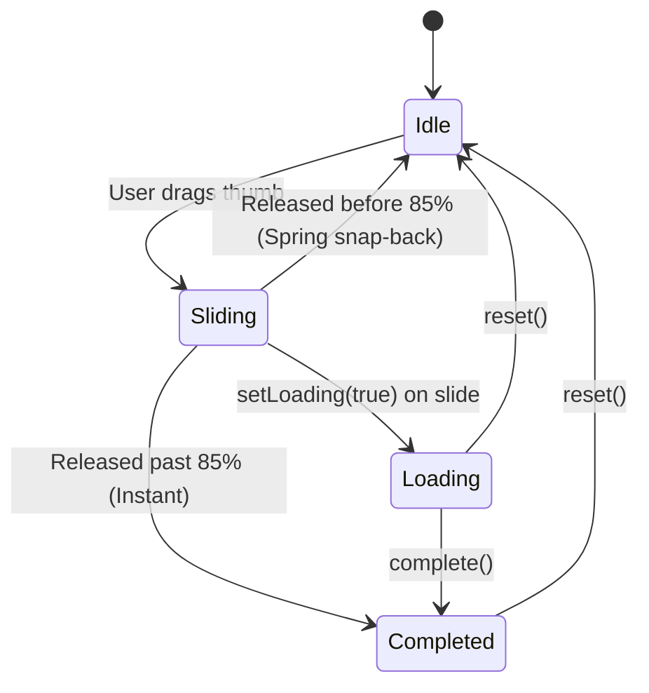

# SlideToConfirmButton for Jetpack Compose

[](https://jitpack.io/#samyak2403/SlidingButton)
[](https://android-arsenal.com/api?level=24)
[](https://kotlinlang.org)
[](https://developer.android.com/jetpack/compose)
[](https://m3.material.io)
[](LICENSE)

A production-ready, highly accessible, and customizable **Slide-to-Confirm / Slide-to-Unlock** component for Android, built completely from scratch using **Jetpack Compose** and **Material 3 Expressive**.

Inspired by the legacy XML library [samyak2403/SlidingButton](https://github.com/samyak2403/SlidingButton), rewritten the modern Compose way using Foundation’s **`AnchoredDraggableState`**, spring physics, and zero-recomposition lambda modifiers.

---

## 📱 Preview & Demo

<p align="center">
  
</p>
<p align="center">
  <em>✨ Interactive Material 3 Expressive Showcase (sample/1.gif)</em>
</p>

---

## 🌟 Why SlideToConfirmButton?

- 🚀 **Built on Compose Foundation**: Powered by `AnchoredDraggableState` and `Modifier.anchoredDraggable()`. No deprecated `Swipeable` or fragile custom touch arithmetic.
- ⚡ **Zero-Recomposition Dragging**: Thumb offsets, progress fills, and label alpha fading execute exclusively inside lambda modifiers (`Modifier.offset {}`, `Modifier.drawBehind {}`, `Modifier.graphicsLayer {}`), guaranteeing buttery smooth 60/120 FPS drags with 0% recomposition churn.
- 🎯 **85% Expressive Snapping**: Physical spring snap-back if released before 85% drag distance, with snappy spring completion if released past the threshold.
- 🌊 **Seamless Progress Track Fill**: Optional progress fill stretching seamlessly behind the thumb, supporting solid colors and horizontal gradient brushes (`Brush.horizontalGradient`) with zero halo or crescent artifacts at rest.
- 🔄 **4-Stage State Machine**: Built-in hoisted `SlideToConfirmState` managing `Idle`, `Sliding`, `Loading`, and `Completed` lifecycle stages. Survives configuration changes via `rememberSaveable`.
- ⏳ **Loading State in Thumb**: Displays an inline `CircularProgressIndicator` during asynchronous tasks, morphing into a checkmark or custom icon with a spring-scale bounce upon completion.
- ✨ **Idle Shimmer Sweep**: Subtle, continuous light sweep across the track label while resting in `Idle` state (rendered via `drawWithContent` and `BlendMode.SrcAtop` for negligible battery and CPU overhead).
- 📳 **Tactile Haptic Feedback**: Automatic `HapticFeedbackType.Confirm` pulse on completion.
- ♿ **First-Class Accessibility (TalkBack)**: Full semantics with both standard `onClick` and `customActions("Confirm")`. TalkBack users can double-tap anywhere on the button to confirm without dragging.
- 🌐 **Full RTL Support**: Drag direction, icons, progress fills, and offsets automatically mirror for right-to-left locales.

---

## 📦 Installation

Add JitPack to your project repositories and include the library dependency.

### Kotlin DSL (`settings.gradle.kts` & `build.gradle.kts`)

```kotlin
// settings.gradle.kts
dependencyResolutionManagement {
    repositoriesMode.set(RepositoriesMode.FAIL_ON_PROJECT_REPOS)
    repositories {
        google()
        mavenCentral()
        maven { url = uri("https://jitpack.io") }
    }
}
```

```kotlin
// build.gradle.kts (Module: app)
dependencies {
    implementation("com.github.samyak2403:SlidingButton:1.0.0")
}
```

### Groovy DSL (`settings.gradle` & `build.gradle`)

```groovy
// settings.gradle
dependencyResolutionManagement {
    repositoriesMode.set(RepositoriesMode.FAIL_ON_PROJECT_REPOS)
    repositories {
        google()
        mavenCentral()
        maven { url 'https://jitpack.io' }
    }
}
```

```groovy
// build.gradle (Module: app)
dependencies {
    implementation 'com.github.samyak2403:SlidingButton:1.0.0'
}
```

---

## 🚀 Quick Start Recipes

### 1. Minimal Payment Slider

```kotlin
import androidx.compose.runtime.Composable
import com.samyak.slidingbutton.SlideToConfirmButton

@Composable
fun PaymentSlider(onPayConfirmed: () -> Unit) {
    SlideToConfirmButton(
        onSlideComplete = onPayConfirmed,
        text = "Slide to pay $49.99"
    )
}
```

---

### 2. Asynchronous Flow with Loading Spinner & Reset

```kotlin
import androidx.compose.foundation.layout.*
import androidx.compose.material3.*
import androidx.compose.runtime.*
import androidx.compose.ui.graphics.Brush
import androidx.compose.ui.graphics.Color
import com.samyak.slidingbutton.*
import kotlinx.coroutines.launch

@Composable
fun AsyncTransferSlider() {
    val coroutineScope = rememberCoroutineScope()
    val state = rememberSlideToConfirmState()

    Column(verticalArrangement = Arrangement.spacedBy(16.dp)) {
        SlideToConfirmButton(
            onSlideComplete = {
                coroutineScope.launch {
                    // 1. Transition thumb into loading spinner
                    state.setLoading(true)

                    // 2. Perform background network task
                    val success = performNetworkTransfer()

                    // 3. Complete or reset based on result
                    if (success) {
                        state.complete()
                    } else {
                        state.reset()
                    }
                }
            },
            state = state,
            text = "Slide to transfer funds",
            showProgressTrack = true,
            progressGradient = Brush.horizontalGradient(
                listOf(Color(0xFF81C784), Color(0xFF2E7D32))
            )
        )

        // Reset button
        if (state.isCompleted) {
            FilledTonalButton(onClick = { coroutineScope.launch { state.reset() } }) {
                Text("Reset Slider")
            }
        }
    }
}
```

---

### 3. Tactical Military / Material Sage "Slide to Unlock"

Matches the Material 3 Expressive sage aesthetic with custom locked/unlocked padlock icons:

```kotlin
import androidx.compose.foundation.layout.size
import androidx.compose.material.icons.Icons
import androidx.compose.material.icons.filled.Lock
import androidx.compose.material.icons.filled.LockOpen
import androidx.compose.material3.*
import androidx.compose.runtime.*
import androidx.compose.ui.Modifier
import androidx.compose.ui.graphics.Brush
import androidx.compose.ui.graphics.Color
import androidx.compose.ui.text.font.FontWeight
import androidx.compose.ui.unit.dp
import androidx.compose.ui.unit.sp
import com.samyak.slidingbutton.*

@Composable
fun SageUnlockSlider() {
    val state = rememberSlideToConfirmState()
    var isUnlocked by remember { mutableStateOf(false) }

    val sageColors = SlideToConfirmDefaults.colors(
        trackColor = Color(0xFF283421),              // Deep Olive Moss
        progressTrackColor = Color(0xFFB8D89C),      // Sage green base
        thumbColor = Color(0xFFB8D89C),              // Light Sage thumb
        thumbIconColor = Color.White,                // White Padlock
        textColor = Color(0xFF859C75),               // Olive label
        completedTrackColor = Color(0xFF38492E),     // Accent Moss upon unlock
        completedThumbColor = Color(0xFFD6ECC0),
        completedThumbIconColor = Color(0xFF283421),
        trackBorderColor = Color(0xFF1B2416)         // Darker contour outline
    )

    val sageProgressGradient = Brush.horizontalGradient(
        listOf(Color(0xFFB8D89C), Color(0xFF50663F))
    )

    SlideToConfirmButton(
        onSlideComplete = { isUnlocked = true },
        state = state,
        text = if (isUnlocked) "UNLOCKED" else "SLIDE TO UNLOCK",
        textStyle = MaterialTheme.typography.labelLarge.copy(
            letterSpacing = 2.sp,
            fontWeight = FontWeight.Bold
        ),
        colors = sageColors,
        progressGradient = sageProgressGradient,
        showProgressTrack = true,
        thumbElevation = 4.dp,
        completedIcon = {
            Icon(
                imageVector = Icons.Default.LockOpen,
                contentDescription = "Unlocked",
                tint = sageColors.completedThumbIconColor,
                modifier = Modifier.size(22.dp)
            )
        },
        thumbIcon = {
            Icon(
                imageVector = Icons.Default.Lock,
                contentDescription = "Locked",
                tint = Color.White,
                modifier = Modifier.size(20.dp)
            )
        }
    )
}
```

---

### 4. Destructive Action with Enable / Disable Switch

```kotlin
@Composable
fun DestructiveSlider(enabled: Boolean, onConfirmed: () -> Unit) {
    val crimsonColors = SlideToConfirmDefaults.colors(
        trackColor = Color(0xFF3B1518),
        progressTrackColor = Color(0xFFB3261E),
        thumbColor = Color(0xFFE25C54),
        thumbIconColor = Color.White,
        textColor = Color(0xFFE89A96),
        completedTrackColor = Color(0xFF601410),
        completedThumbColor = Color(0xFFF9DEDC),
        completedThumbIconColor = Color(0xFF601410),
        trackBorderColor = Color(0xFF2B0E11)
    )

    SlideToConfirmButton(
        onSlideComplete = onConfirmed,
        text = "Slide to delete account",
        enabled = enabled,
        colors = crimsonColors,
        progressGradient = Brush.horizontalGradient(
            listOf(Color(0xFFE25C54), Color(0xFFB3261E))
        )
    )
}
```

---

## 🏗️ State Machine Architecture

The component is driven by an explicit 4-stage state machine:



### Observable Properties & Methods

```kotlin
val state = rememberSlideToConfirmState()

// Observable properties:
state.status       // SlideToConfirmStatus.Idle | Sliding | Loading | Completed
state.progress     // Float between 0.0f and 1.0f
state.offset       // Current pixel drag offset (Float)
state.isIdle       // Boolean
state.isSliding    // Boolean
state.isLoading    // Boolean
state.isCompleted  // Boolean

// State transition methods:
state.setLoading(true)     // Shows CircularProgressIndicator in thumb
state.complete()           // Animates to Completed and invokes completion
state.reset()              // Snaps thumb back to Idle (0 offset)
```

Configuration changes (like device orientation flips) are handled automatically via an internal `Saver` implementation.

---

## ⚙️ Complete API Reference

### `SlideToConfirmButton`

| Parameter | Type | Default | Description |
| :--- | :--- | :--- | :--- |
| **`onSlideComplete`** | `() -> Unit` | *(Required)* | Invoked when user releases thumb past the 85% threshold or completes via TalkBack. |
| **`modifier`** | `Modifier` | `Modifier` | Layout modifier applied to the outer container. |
| **`state`** | `SlideToConfirmState` | `rememberSlideToConfirmState()` | Hoisted state holder managing anchors, offsets, and lifecycle. |
| **`text`** | `String` | `"Slide to confirm"` | Label displayed inside the track, fading as the thumb slides. |
| **`textStyle`** | `TextStyle` | `MaterialTheme.typography.titleMedium` | Typography styling for the track label. |
| **`colors`** | `SlideToConfirmColors` | `SlideToConfirmDefaults.colors()` | Palette tokens for track, thumb, text, and completed states. |
| **`shape`** | `Shape` | `CircleShape` | Corner shape for the outer track and draggable thumb. |
| **`trackHeight`** | `Dp` | `56.dp` | Overall height of the slide button. |
| **`thumbSize`** | `Dp` | `48.dp` | Diameter of the draggable circular thumb. |
| **`trackPadding`** | `Dp` | `4.dp` | Internal padding between track boundary and draggable thumb. |
| **`thumbElevation`** | `Dp` | `3.dp` | Elevation shadow rendered under the draggable thumb. |
| **`showProgressTrack`** | `Boolean` | `true` | When true, renders a filled progress track behind the sliding thumb. |
| **`progressGradient`** | `Brush?` | `null` | Optional horizontal gradient brush for the progress fill. |
| **`shimmerLabel`** | `Boolean` | `true` | Toggles subtle shimmering sweep across the label while in idle state. |
| **`enabled`** | `Boolean` | `true` | When false, locks thumb, applies disabled colors, and disables accessibility actions. |
| **`snapAnimationSpec`**| `AnimationSpec<Float>`| `ExpressiveSpringSpec` | Spring physics specification for snapping back or completing. |
| **`completedIcon`** | `@Composable (() -> Unit)?` | `null` | Optional slot for custom completed thumb icon (defaults to checkmark). |
| **`thumbIcon`** | `@Composable (SlideToConfirmStatus) -> Unit` | Arrow Forward | Composable slot for the icon inside the thumb during idle/sliding states. |

---

### `SlideToConfirmColors`

Configured via `SlideToConfirmDefaults.colors(...)`:

| Token | Default Value | Description |
| :--- | :--- | :--- |
| **`trackColor`** | `colorScheme.surfaceContainerHighest` | Base background color of the outer track. |
| **`progressTrackColor`** | `colorScheme.primaryContainer` | Solid color filled behind the sliding thumb. |
| **`thumbColor`** | `colorScheme.primary` | Background color of the draggable circular thumb. |
| **`thumbIconColor`** | `colorScheme.onPrimary` | Tint color of the thumb icon during idle and sliding states. |
| **`textColor`** | `colorScheme.onSurfaceVariant` | Label text color inside the track. |
| **`completedTrackColor`** | `colorScheme.primary` | Track background color when state reaches `Completed`. |
| **`completedThumbColor`** | `colorScheme.surface` | Thumb background color when completed. |
| **`completedThumbIconColor`**| `colorScheme.primary` | Completed icon tint color (e.g. checkmark). |
| **`disabledTrackColor`** | `onSurface.copy(alpha = 0.12f)` | Track background color when `enabled = false`. |
| **`disabledThumbColor`** | `onSurface.copy(alpha = 0.38f)` | Thumb color when `enabled = false`. |
| **`disabledTextColor`** | `onSurface.copy(alpha = 0.38f)` | Label text color when `enabled = false`. |
| **`disabledThumbIconColor`**| `colorScheme.surface` | Thumb icon tint when `enabled = false`. |
| **`trackBorderColor`** | `Color.Transparent` | Optional stroke outline around the outer track. |

---

## ♿ Accessibility & RTL

### TalkBack Support
For users who rely on screen readers or cannot perform continuous drag gestures:
- The entire slider is annotated with `Role.Button`.
- Both `onClick` and `customActions("Confirm")` are registered with the Compose semantics tree.
- A TalkBack user can simply **double-tap anywhere on the track or thumb** to activate confirmation instantly.

### RTL (Right-to-Left)
Full support for RTL layouts (e.g. Arabic, Hebrew):
- The draggable anchor direction automatically inverts (`reverseDirection = isRtl`).
- Thumb offsets smoothly slide from right to left (`IntOffset(-offset, 0)`).
- Progress fill originates on the right boundary and extends toward the left.
- Thumb arrows automatically mirror using `Icons.AutoMirrored.Filled.ArrowForward`.

---

## 🧪 Testing

The library includes both JVM unit tests and on-device instrumentation tests.

```bash
# Run JVM state machine unit tests
./gradlew test

# Run Android instrumentation tests (Compose UI swipe tests)
./gradlew connectedAndroidTest
```

### Compose UI Test Example

```kotlin
@Test
fun swipeRight_triggersOnSlideComplete() {
    var completed = false
    composeTestRule.setContent {
        SlideToConfirmButton(
            onSlideComplete = { completed = true },
            modifier = Modifier.testTag("SlideButton")
        )
    }

    // Perform swipe gesture
    composeTestRule.onNodeWithTag("SlideButton").performTouchInput {
        swipeRight()
    }

    assertTrue(completed)
}
```

---

## 📱 Sample Demo Application

An interactive sample showcase is included in the `:app` module, demonstrating 4 different styles:
1. **Material Sage**: Tactical military slider with padlock lock/unlock transition.
2. **Sapphire Blue**: High-intent payment slider with subtle elevation.
3. **Emerald Green**: Multi-stage async order transfer with spinner and reset controls.
4. **Crimson Red**: Destructive action confirmation with toggle switch.

To install and run on a connected device:

```bash
./gradlew :app:installDebug
```

---

## 🛠️ Building from Source & JitPack Deployment

This project uses modern Android tooling:
- **Gradle 9.x** with Version Catalog (`gradle/libs.versions.toml`).
- **Android Gradle Plugin (AGP) 9.4.1** (requires JDK 21+).
- **Maven Publish Plugin** configured for JitPack (`jitpack.yml`).

```bash
# Build library AAR
./gradlew :slidingbutton:assembleRelease

# Publish to local maven repository
./gradlew :slidingbutton:publishToMavenLocal
```

---

## 📄 License

```
Copyright 2026 SlideToConfirmButton Contributors

Licensed under the Apache License, Version 2.0 (the "License");
you may not use this file except in compliance with the License.
You may obtain a copy of the License at

    http://www.apache.org/licenses/LICENSE-2.0

Unless required by applicable law or agreed to in writing, software
distributed under the License is distributed on an "AS IS" BASIS,
WITHOUT WARRANTIES OR CONDITIONS OF ANY KIND, either express or implied.
See the License for the specific language governing permissions and
limitations under the License.
```
